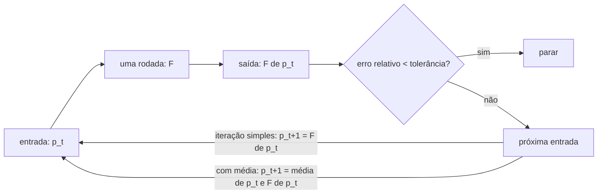
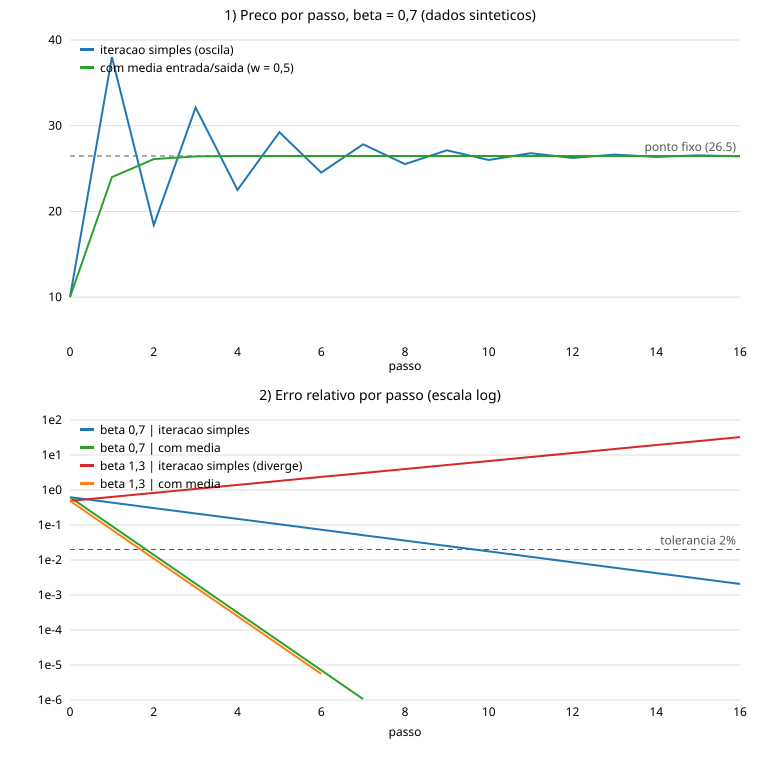

# Ponto fixo e oscilação: quando a saída de uma etapa alimenta a entrada da seguinte

> **English summary.** What happens when the output of a stage becomes the input of the next one, again and again (iterative calibration, price adjustment, chained simulations)? A synthetic cobweb price model (how a market price adjusts when supply reacts with a delay; not a company pricing tool) shows the pattern: a *negative ratio between successive steps* means oscillation, a ratio below 1 in absolute value means convergence, three points are enough to extrapolate the fixed point (Aitken), noise degrades that estimate, and averaging input and output can stop an oscillation, or rescue a divergent loop, but is not always faster. Pure Python, no dependencies, all data synthetic.

Pergunta de abertura: se cada rodada usa como entrada o resultado da anterior, **como saber se o processo vai chegar a algum lugar, e quando parar de gastar com novas rodadas?**

**Status:** estudo concluído (v1). O modelo é propositalmente simples para que cada afirmação possa ser conferida na conta.

## Conteúdo

| Caminho | O que é |
|---|---|
| `simulacao.py` | Modelo, experimentos e geração do gráfico. Só biblioteca padrão do Python. |
| `teste_simulacao.py` | 7 testes que conferem as propriedades matemáticas (ponto fixo, razão entre passos, Aitken, média). |
| `grafico.svg` | Gráfico gerado pelo script (preço por passo e erro em escala log). |
| `LICENSE` | MIT. |

## Como funciona

Modelo "teia de aranha" de preços, com números sintéticos. **Não é um modelo de precificação para uma empresa**, e sim de como o preço de um mercado se ajusta quando a oferta reage com atraso. Os compradores reagem ao preço de hoje; os produtores decidem com o preço de ontem:

- demanda: `D(p_t) = c − d · p_t`
- oferta: `S(p_t−1) = a + b · p_t−1`
- o mercado limpa em `p_t = F(p_t−1) = α − β · p_t−1`, com `β = b / d`



Neste modelo linear tudo tem forma fechada, o que permite conferir os experimentos:

- ponto fixo: `p* = α / (1 + β)`
- razão entre passos sucessivos: `(p_t+1 − p_t) / (p_t − p_t−1) = −β`
- `β < 1`: oscilação amortecida, converge. `β = 1`: oscila sem parar. `β > 1`: diverge.
- média da entrada com a saída (`w = 1/2`): a razão vira `(1 − w) − w·β`, que fica entre −1 e 1 para `β` até 3.

O critério de parada (erro relativo menor que 2%) foi **escrito antes de rodar**.

## Resultados

Preço de equilíbrio com `β = 0,7`: 26,47. Preço inicial: 10.



**Experimento 1: iteração simples, β = 0,7.** O preço oscila em torno do ponto fixo e a razão entre passos é constante, −0,700.

| passo | preço | erro relativo | razão entre passos |
|---:|---:|---:|---:|
| 0 | 10,000 | 62,2% | |
| 1 | 38,000 | 43,6% | |
| 2 | 18,400 | 30,5% | −0,700 |
| 3 | 32,120 | 21,3% | −0,700 |
| 4 | 22,516 | 14,9% | −0,700 |
| 5 | 29,239 | 10,5% | −0,700 |
| 6 | 24,533 | 7,3% | −0,700 |
| 7 | 27,827 | 5,1% | −0,700 |
| 8 | 25,521 | 3,6% | −0,700 |
| 9 | 27,135 | 2,5% | −0,700 |
| 10 | 26,005 | 1,8% | −0,700 |

**Experimento 2: Aitken com 3 pontos, sem ruído.** Estima o ponto de chegada sem precisar esperar a convergência.

| beta | ponto fixo exato | estimativa (3 pontos) |
|---:|---:|---:|
| 0,3 | 34,6154 | 34,6154 |
| 0,7 | 26,4706 | 26,4706 |
| 0,9 | 23,6842 | 23,6842 |

**Experimento 3: passos até o erro relativo ficar abaixo de 2%.**

| beta | iteração simples | média entrada/saída (w = 0,5) |
|---:|---:|---:|
| 0,3 | 3 | 4 |
| 0,7 | 10 | 2 |
| 0,9 | 32 | 2 |
| 1,3 | não converge | 2 |

**Experimento 4: Aitken com ruído** (2000 repetições, semente fixa, β = 0,7). O ruído é somado à saída de cada rodada.

| ponto de partida | ruído (desvio) | erro mediano | erro no percentil 90 |
|---|---:|---:|---:|
| longe do equilíbrio (10) | 0,0 | 0,0% | 0,0% |
| longe do equilíbrio (10) | 0,5 | 0,5% | 1,3% |
| longe do equilíbrio (10) | 1,0 | 1,1% | 2,6% |
| longe do equilíbrio (10) | 2,0 | 2,2% | 5,2% |
| perto do equilíbrio (25) | 0,0 | 0,0% | 0,0% |
| perto do equilíbrio (25) | 0,5 | 0,6% | 1,5% |
| perto do equilíbrio (25) | 1,0 | 1,4% | 5,6% |
| perto do equilíbrio (25) | 2,0 | 3,1% | 8,5% |

## O que os dados mostram

1. **A razão entre passos diz o que vai acontecer.** Negativa significa oscilação. Com módulo menor que 1, converge, e a velocidade vem do módulo.
2. **Três pontos já dão uma estimativa do destino.** Sem ruído, ela é exata. Isso evita gastar rodadas só para confirmar o que a razão já indica.
3. **O ruído piora a estimativa, e piora mais quando o passo é pequeno diante do ruído.** Com ruído 1,0, o erro no percentil 90 foi 2,6% partindo de longe e 5,6% partindo de perto.
4. **Fazer a média entre entrada e saída pode acabar com a oscilação** (2 passos contra 10 com β = 0,7) **e resgatar um laço que diverge** (β = 1,3). **Mas não é sempre melhor:** com β = 0,3 foram 4 passos contra 3. Por isso a média é uma escolha explícita, com o peso à vista, e não um ajuste escondido.
5. **O critério de parada escrito antes impede de decidir depois de ver o resultado.**

## Limitações

- É um modelo linear de **uma variável**. Sistemas reais são não lineares e têm várias variáveis, e a razão entre passos muda de um componente para outro.
- O método de Aitken assume convergência geométrica. Fora disso, a estimativa de 3 pontos pode enganar. Lembrete do mesmo tipo de armadilha: **amostra pequena engana.**
- O ruído simulado é gaussiano, independente entre rodadas, com 2000 repetições e uma semente. Ruído real costuma ser mais feio.
- O peso `w = 0,5` da média é uma escolha. Não otimizei esse valor.
- Isto ilustra um método. Não prova nada sobre nenhum sistema real.

## Como reproduzir

```text
python simulacao.py          # imprime os experimentos e regenera grafico.svg
python -m unittest           # roda os 7 testes
```

Sem dependências além do Python 3. A semente é fixa, então os números das tabelas se repetem.

## Meu papel, com precisão

Defini a pergunta, os parâmetros sintéticos e o critério de parada antes de rodar, e li e validei os resultados. O código foi escrito com apoio de IA (Claude). Não escrevo código sozinho.

## Dados

Todos os dados são sintéticos, gerados por código com semente fixa. Nada aqui vem de dados reais de nenhum projeto ou empresa.

## Licença

MIT. Veja `LICENSE`.
